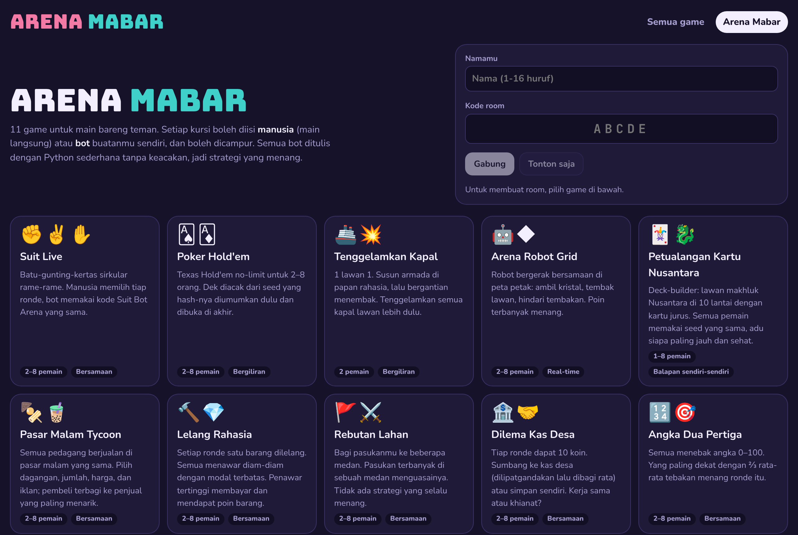
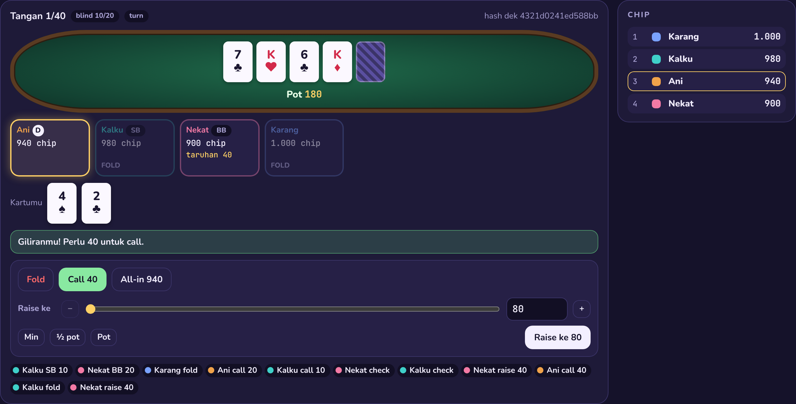
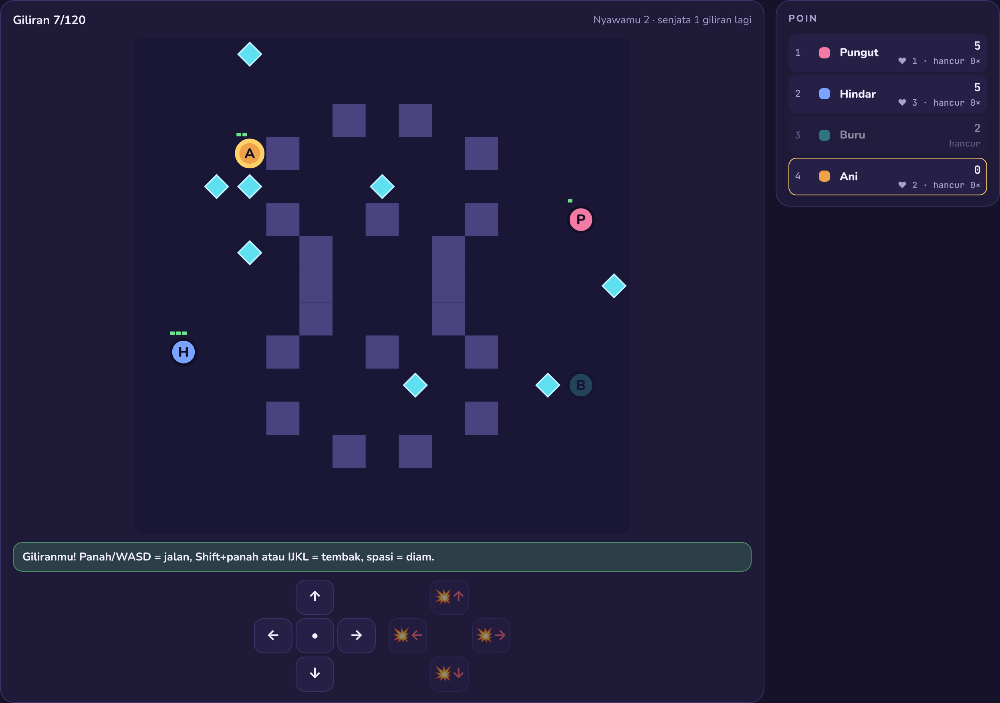
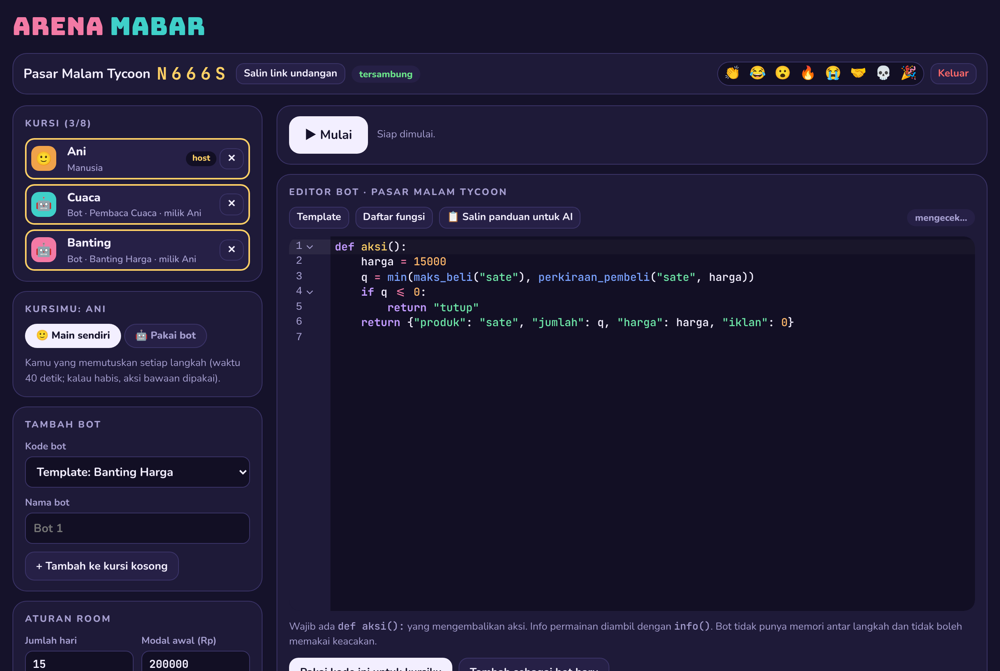
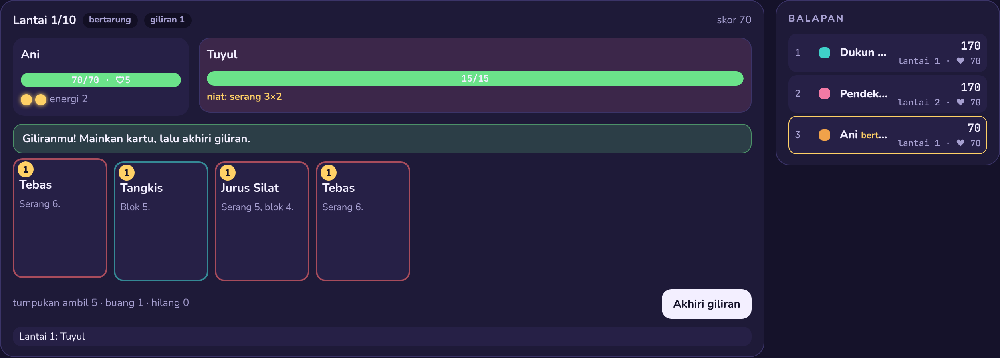
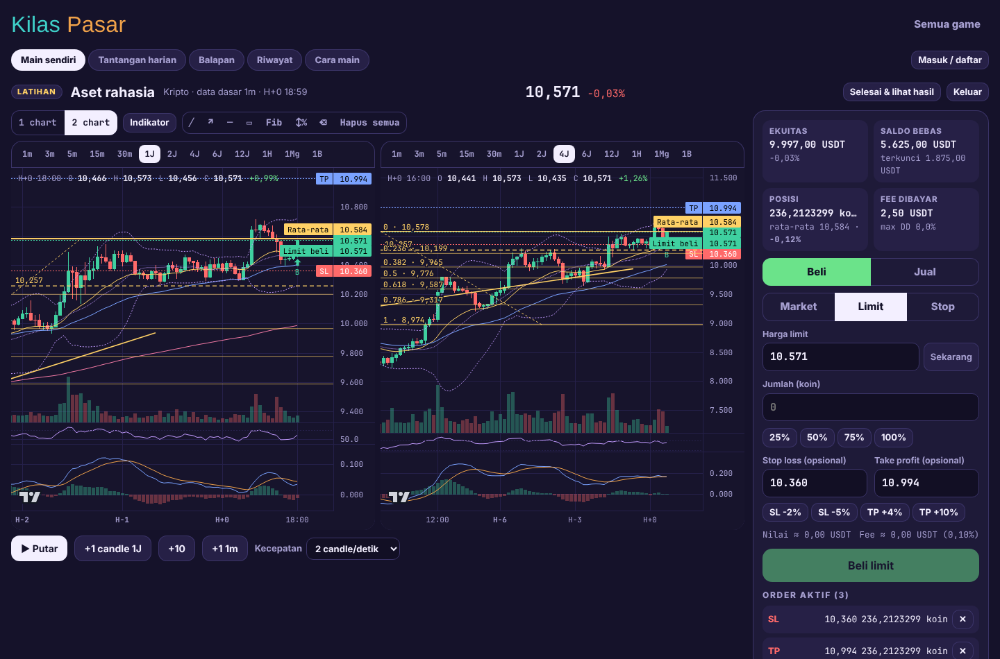
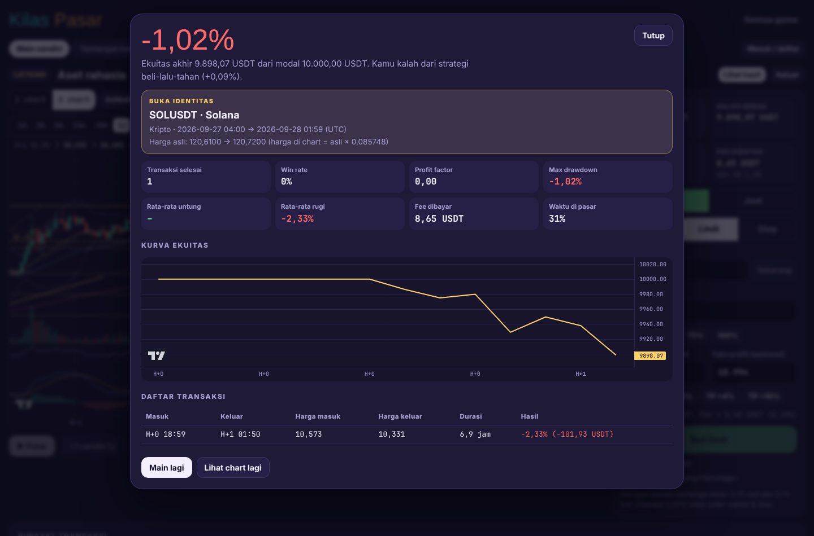
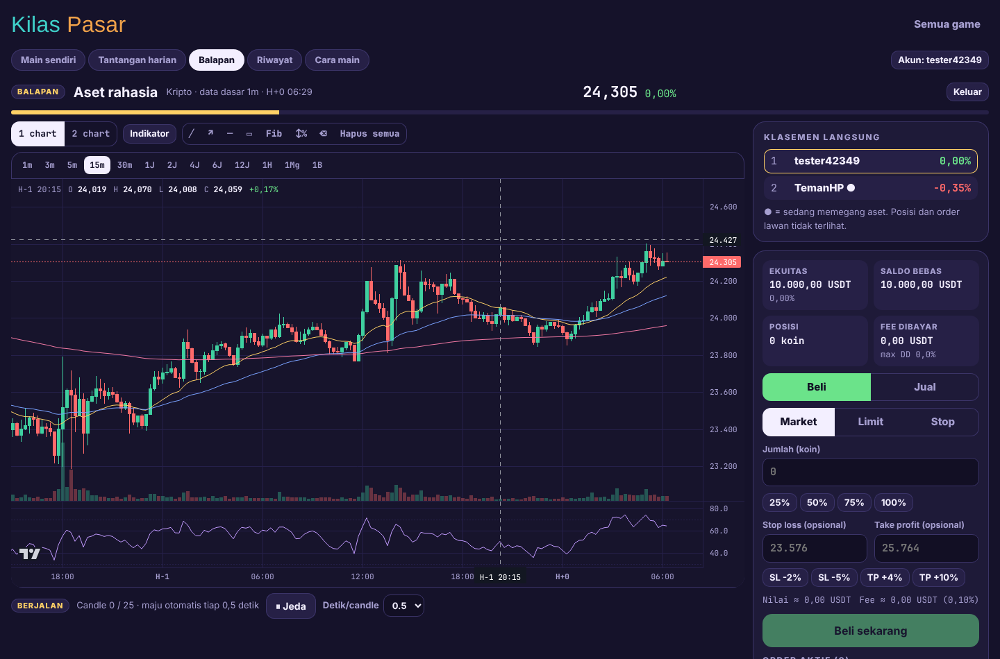

# Game Mabar BTK

Kumpulan game browser untuk dimainkan bareng teman, dalam satu server:

| Game | Ringkasnya |
|---|---|
| **Arena Mabar** | 11 game main bareng: poker, tenggelamkan kapal, robot arena, deck-builder, tycoon, lelang, dan lainnya. Setiap kursi boleh **manusia atau bot**, dan boleh dicampur. |
| **Suit Bot Arena** | Program bot batu-gunting-kertas dengan blok ala Scratch atau Python, lalu adu dengan bot teman (2–8 pemain) sampai HP habis. Ada turnamen, mode event, debugger, dan liga. |
| **Kilas Pasar** | Simulasi trading dengan candle **asli** kripto, saham IDX, dan saham US. Mode buta, fee realistis, indikator & alat gambar. Main sendiri, tantangan harian, atau balapan bareng teman. |

**Daftar semua game dan cara mainnya: [docs/GAMES.md](docs/GAMES.md).**

---

## Arena Mabar

Satu room, satu kode, dan setiap kursi bisa diisi siapa saja: teman yang main langsung lewat tombol di layar, atau bot yang ditulis
dengan Python sederhana. Kursimu sendiri bisa diganti jadi bot kapan saja di lobby, lalu dikembalikan lagi.



| Game | Pemain | Jenis |
|---|---|---|
| Suit Live | 2–8 | Batu-gunting-kertas sirkular, bot Suit Bot Arena bisa dipakai langsung |
| Poker Hold'em | 2–8 | Texas Hold'em no-limit, side pot, blind naik, dek dengan hash seed yang bisa dicek |
| Tenggelamkan Kapal | 2 | Susun armada rahasia, bergantian menembak |
| Arena Robot Grid | 2–8 | Real-time di peta petak: kristal, tembakan, bangkit lagi |
| Petualangan Kartu Nusantara | 1–8 | Deck-builder 10 lantai, seed sama untuk semua, balapan skor |
| Pasar Malam Tycoon | 2–8 | Pasar bersama: produk, harga, iklan, cuaca |
| Lelang Rahasia | 2–8 | Tawaran tertutup dengan modal terbatas |
| Rebutan Lahan | 2–8 | Bagi pasukan ke beberapa medan (Colonel Blotto) |
| Dilema Kas Desa | 2–8 | Kerja sama atau khianat (public goods) |
| Angka Dua Pertiga | 2–8 | Tebak ⅔ rata-rata |
| Pasar Malam Sepi | 2–12 | Datang atau di rumah (El Farol) |

- **Kursi manusia/bot campur**, timer per langkah (aksi bawaan kalau waktu habis atau offline), host mengatur aturan per game.
- **Semua bot = semua kursi bot**: dengan jeda 0, server langsung menghitung match lalu memutar replay.
- **Penonton** (rahasia lawan tetap tersembunyi) dan **reaksi emoji** yang melayang di layar semua orang.
- **Replay** langkah demi langkah, log bot pribadi, dan rahasia yang dibuka di akhir (seed poker, armada kapal).
- **Latihan bot** melawan template, **panduan bot untuk AI** per game ([docs/bot/](docs/bot/README.md)), dan **liga ELO** per game untuk akun.
- Bot tanpa keacakan dan tanpa memori: semua keacakan milik game, diturunkan dari seed match.

| Poker | Robot Grid |
|---|---|
|  |  |

| Lobby: manusia + bot | Petualangan Kartu |
|---|---|
|  |  |

---

## Kilas Pasar

Kamu dilempar ke satu titik di masa lalu. Candle berikutnya belum terlihat: putuskan beli atau jual, lalu majukan waktu candle demi candle (atau putar otomatis). Server memegang semua data, jadi candle masa depan tidak bisa diintip dari browser.



**Fitur**

- **Data pasar asli.**
  - Kripto dari arsip publik Binance: candle 1 menit sejak 2017.
  - Saham IDX dan US dari Yahoo Finance.
- **13 timeframe** (1m, 3m, 5m, 15m, 30m, 1j, 2j, 4j, 6j, 12j, 1h, 1mg, 1b) yang tetap sinkron saat diganti. Candle timeframe besar tampil "sedang terbentuk", dan bisa dilihat dalam tampilan 2 chart sekaligus.
- **Mode buta** (default): nama aset, tanggal, dan level harga disamarkan. Persentase gerakan harga tetap persis sama. Identitas aslinya dibuka di layar hasil.
- **Spot penuh dengan modal dan fee.**
  - Jenis order: market, limit, stop buy (breakout), stop loss, take profit, dan pasangan OCO.
  - Fee dan slippage bisa diatur.
  - Saham IDX memakai lot 100 lembar.
- **Indikator:** EMA/SMA (hingga 5 periode), Bollinger Bands, VWAP, volume, RSI, MACD, Stochastic, ATR.
- **Alat gambar:** garis tren, sinar, garis horizontal, kotak zona, Fibonacci, dan alat ukur (%, jumlah candle). Gambar ikut tampil di semua timeframe.
- **Tiga mode main:**
  - Main sendiri.
  - Tantangan harian: soal sama untuk semua orang, ada papan peringkat, dan hanya percobaan pertama yang dinilai.
  - Balapan: room untuk sampai 20 orang, candle maju otomatis, dengan klasemen langsung.
- **Layar hasil:** return dibanding strategi beli-lalu-tahan, win rate, profit factor, max drawdown, fee, kurva ekuitas, dan daftar transaksi.
- **Akun** (opsional) untuk papan peringkat dan riwayat hasil.

| Hasil sesi | Balapan |
|---|---|
|  |  |

**Data pasar** diunduh sekali, lalu bisa di-update kapan saja:

| Preset | Isi | Waktu & ukuran |
|---|---|---|
| `cepat` | 5 kripto (1m sejak 2024-07), 30 saham IDX, 20 saham US | beberapa menit, <1 GB |
| `penuh` | ±65 kripto (1m sejak 2017), ±140 saham IDX, ±90 saham US | beberapa jam, puluhan GB |
| `update` | data terbaru untuk semua aset yang sudah ada | jalankan rutin |
| `contoh` | data buatan, tanpa internet | instan |

- Windows: `scripts\unduh-data.bat`
- Mac/Linux: `./scripts/unduh-data.sh cepat`
- Tanpa Docker: `python -m app.trading.unduh semua --preset cepat` dari folder `backend`

Aturan eksekusi order dijelaskan lengkap di halaman **Cara main** di dalam game.

---

## Suit Bot Arena

Pemain tidak memilih senjata sendiri. Yang memilih adalah **algoritma botmu**, dijalankan setiap ronde tanpa unsur acak. Strategi lawan tersembunyi; yang terlihat hanya pilihan mereka di ronde-ronde sebelumnya. Bot bisa dibuat dengan **blok visual**, **Python**, atau dibuatkan **AI** dengan menempelkan [panduan lengkap](docs/PANDUAN_BOT_LLM.md).


- **Room multiplayer**: kode 5 huruf dan link undangan. Host mengatur HP awal, HP hilang saat kalah, batas ronde, ingatan bot, dan **mode event**
  (Taruhan Ganda, Pikun, Kilat, Darah Tipis, Kabut, Kejutan).
- **Turnamen 1 lawan 1** setengah kompetisi (menang 3, seri 1) dengan klasemen, matriks hasil, dan replay tiap pasangan.
- **Penonton + reaksi emoji**, dan **liga ELO** untuk pemain yang masuk akun.
- **Replay animasi**: bot berpikir, kartu dibuka, bot berkumpul ke 3 kotak senjata, aliran HP, rincian pembagian poin, dan podium.
- **Debugger langkah demi langkah**: jalankan ulang botmu di ronde mana pun dengan info yang sama persis, telusuri baris demi baris beserta isi variabel.
- **Editor blok** (Blockly) dan **editor kode** (CodeMirror), dengan pesan error per baris dalam bahasa Indonesia.
- **Arena latihan** melawan 11 bot contoh.
- **Aman untuk VPS**: kode bot dijalankan interpreter khusus dengan batas langkah, memori, dan rekursi.

Aturan: setiap bot yang senjatanya dikalahkan kehilangan 100 HP (bisa diatur), lalu HP itu dibagi rata ke golongan pemenang. Aturannya sirkular, jadi kalau ketiga senjata muncul, setiap golongan sekaligus menang dan kalah. Sisa pembagian diberikan ke pemenang ber-HP terendah.

```python
def pilih():
    if ronde() == 1:
        return KERTAS
    return pengalah(terbanyak(jumlah_terakhir()))   # lawan senjata terpopuler
```

---

## Menjalankan

| Situasi | Panduan |
|---|---|
| Main dari laptop, dibuka ke internet lewat Cloudflare Tunnel | [MAIN-LOKAL.md](MAIN-LOKAL.md): Windows klik dua kali `scripts\main-lokal.bat`, Mac/Linux `./scripts/main-lokal.sh` |
| Deploy ke VPS (Nginx/Caddy, HTTPS, update data rutin) | [DEPLOY.md](DEPLOY.md) |

Development (Python 3.12+, Node 20+):

```bash
cd backend && python3 -m venv .venv && . .venv/bin/activate && pip install -r requirements-dev.txt
```

```bash
uvicorn app.main:app --reload --port 8000
```

```bash
cd frontend && npm install && npm run dev
```

Buka http://localhost:5173. Vite meneruskan `/api` dan `/ws` ke backend di port 8000.

## Tes

```bash
cd backend && pytest -q
```

Tes Arena Mabar mencakup aturan tiap game (evaluator & side pot poker, tabrakan robot, armada kapal, energi/racun kartu, pembagian
pembeli tycoon, dll.), semua template bot bermain sampai selesai secara deterministik, alur room lewat WebSocket (manusia + bot campur,
penonton, reaksi, waktu habis, mode instan, rating), dan dokumen `docs/bot/` yang harus selalu sama dengan definisi game.
Tes Suit Bot Arena mencakup mode event, turnamen, dan debugger yang harus menghasilkan pilihan yang sama dengan match aslinya.

Tes backend Kilas Pasar mencakup:
- agregasi timeframe dan zona waktu bursa
- parser arsip Binance (termasuk timestamp mikrodetik 2025)
- eksekusi order (fee, slippage, gap, urutan SL/TP di dalam candle, OCO, lot IDX)
- **tidak ada candle masa depan yang bocor** untuk setiap timeframe
- mode buta
- akun, tantangan harian, dan balapan lewat WebSocket

## Struktur proyek

```
backend/app/
  engine/, bot/, rooms/      Suit Bot Arena: aturan, event, interpreter bot aman (dengan jejak debugger), room, turnamen
  games/
    base.py, runtime.py      kontrak game umum + menjalankan bot di sandbox yang sama
    rooms.py, api.py         room Arena Mabar (kursi manusia/bot, timer, penonton, reaksi), REST & WebSocket /ws/main
    g_*.py, registry.py      11 game (poker, kapal, robot, kartu, tycoon, lelang, dst.)
    guide.py, gen_docs.py    panduan bot markdown per game (python -m app.games.gen_docs → docs/bot/)
  trading/
    timeframes.py, store.py  format candle, agregasi multi-timeframe, katalog (memmap)
    ingest_binance.py        pengunduh arsip Binance
    ingest_yahoo.py          pengunduh Yahoo Finance (IDX & US)
    unduh.py                 CLI: python -m app.trading.unduh ...
    session.py               tampilan sesi replay (tanpa bocor masa depan, mode buta)
    engine.py                akun spot: order, eksekusi per candle, fee, statistik
    service.py, api.py       solo, harian, balapan, REST & WebSocket /ws/pasar
    accounts.py              akun & papan peringkat (SQLite)
frontend/src/
  games/                     Arena Mabar: hub, room, editor bot per game, replay umum
    renderers/               tampilan + kontrol manusia tiap game
  trading/                   Kilas Pasar: chart (lightweight-charts), indikator, alat gambar, panel order
  replay/, editor/, views/   Suit Bot Arena
docs/                        GAMES.md (semua game & cara main), bot/ (panduan bot per game), panduan Suit untuk AI, screenshot
scripts/                     main dari laptop + tunnel, unduh data (Windows/Mac/Linux)
deploy/                      contoh Nginx/Caddy + script update
```

## Konfigurasi

Semua konfigurasi lewat `.env` (lihat `.env.example`): `PORT`, `BIND_ADDRESS`, `MATCH_WORKERS`, `BOT_MAX_STEPS`, `MAX_ROOMS`, `PLAYER_GRACE_SECONDS`, `ROOM_IDLE_SECONDS`, `PRACTICE_CONCURRENCY`, `MEM_LIMIT`, `CPUS`, `PASAR_DATA`.

Data Kilas Pasar (candle) dan database akun (akun, papan peringkat, rating liga semua game) disimpan di volume Docker `pasar-data`,
atau di folder `data/` kalau dijalankan tanpa Docker. Room semua game hanya ada di memori server.

Semua uang di Kilas Pasar virtual. Ini alat latihan membaca chart, bukan saran investasi.
