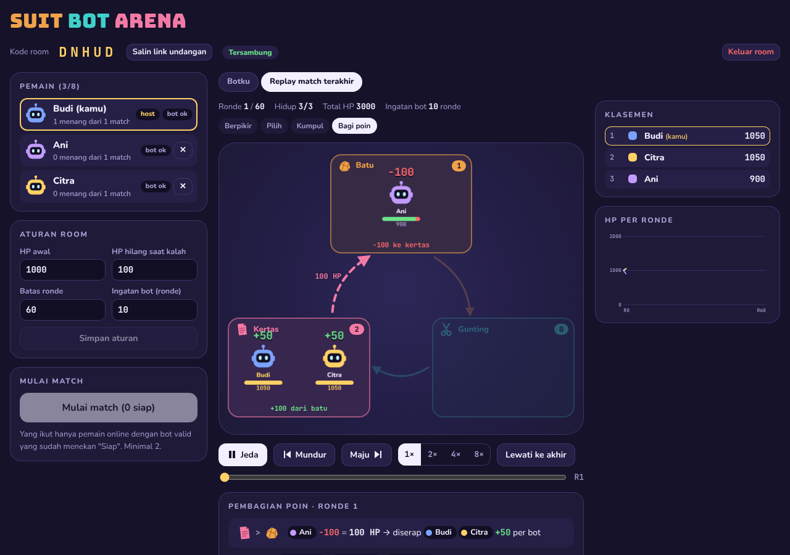
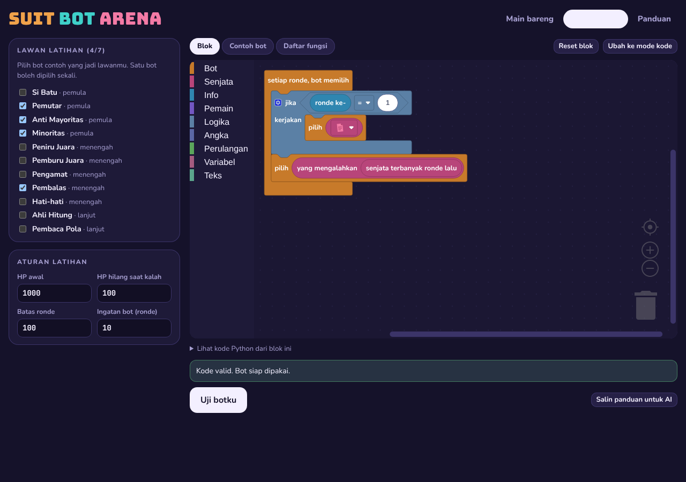
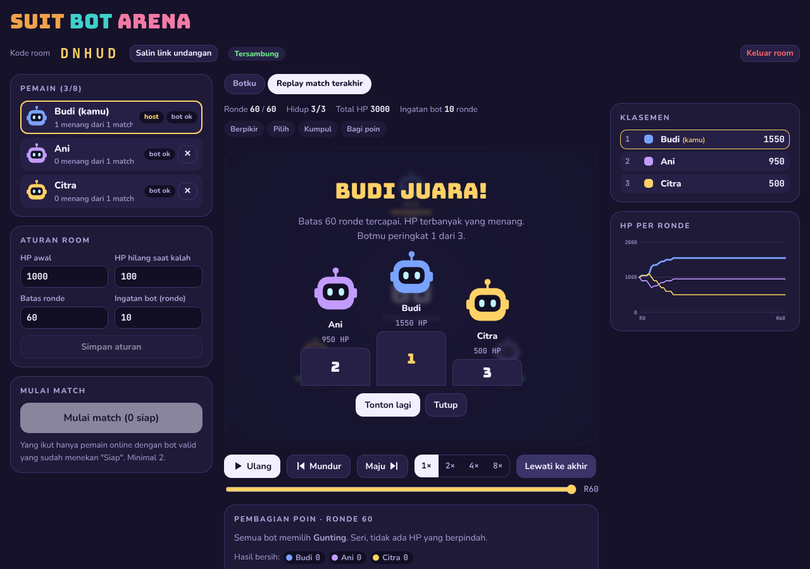

# Suit Bot Arena

Game browser multiplayer: kamu dan teman-temanmu (2 sampai 8 orang per room) membuat **bot batu-gunting-kertas**, lalu bot-bot itu bertarung sampai HP lawan habis. Pemain tidak memilih senjata sendiri. Yang memilih adalah **algoritma botmu**, dan algoritma itu dijalankan setiap ronde tanpa unsur acak sama sekali. Strategi lawan tersembunyi; yang terlihat hanya pilihan mereka di ronde-ronde sebelumnya.

Bot bisa dibuat dengan **blok visual ala Scratch**, ditulis langsung dalam **Python**, atau dibuatkan oleh **AI** (ChatGPT/Claude/Gemini) dengan menempelkan [panduan lengkap](docs/PANDUAN_BOT_LLM.md).



## Fitur

- **Room multiplayer** dengan kode 5 huruf dan link undangan. Banyak room bisa berjalan bersamaan. Host bisa mengatur aturan dan mengeluarkan pemain. Pemain tersambung ulang otomatis kalau halaman di-refresh.
- **Aturan yang bisa diatur host:** HP awal, HP hilang saat kalah, batas ronde, dan ingatan bot (berapa ronde terakhir yang boleh dilihat bot).
- **Replay animasi**: bot berpikir, kartu dibuka, bot berkumpul ke 3 kotak senjata, panah siapa mengalahkan siapa, aliran HP, rincian pembagian poin, klasemen, grafik HP, dan podium.
- **Editor blok** (Blockly, gaya Scratch) dengan blok khusus game, dan **editor kode** (CodeMirror) dengan autocomplete library serta penanda error per baris dalam bahasa Indonesia.
- **Arena latihan**: uji botmu melawan 11 bot contoh, lengkap dengan log `print()` dan error per ronde.
- **Buka kartu**: setelah match, setiap pemain boleh memilih untuk memperlihatkan kode botnya.
- **Aman untuk VPS**: kode bot dijalankan interpreter khusus yang hanya mengizinkan fitur tertentu, dengan batas langkah, memori, dan rekursi.

## Aturan singkat

- Setiap ronde semua bot memilih **BATU, GUNTING, atau KERTAS** bersamaan. Aturannya **sirkular**: kalau ketiganya muncul, setiap golongan menang atas satu golongan dan kalah dari golongan lain.
- Setiap bot yang senjatanya dikalahkan kehilangan **100 HP** (bisa diatur). HP itu dikumpulkan lalu **dibagi rata ke golongan pemenang**. Sisa pembagian tidak dibuang: +1 ke pemenang ber-HP terendah lebih dulu.
- HP 0 berarti gugur. Yang terakhir bertahan menang, atau HP terbanyak saat batas ronde tercapai.
- Bot **tidak punya memori** antar ronde. Semua informasi diambil dari riwayat yang diberikan game (dibatasi sebanyak "ingatan" ronde terakhir).

Contoh bot:

```python
def pilih():
    if ronde() == 1:
        return KERTAS
    return pengalah(terbanyak(jumlah_terakhir()))   # lawan senjata terpopuler
```

Daftar lengkap fungsi, contoh, dan ide strategi ada di [docs/PANDUAN_BOT_LLM.md](docs/PANDUAN_BOT_LLM.md). File itu juga bisa disalin dari tombol **"Salin panduan untuk AI"** di dalam game.

| Editor blok | Akhir match |
|---|---|
|  |  |

## Struktur proyek

```
backend/                 Python 3.12 + FastAPI
  app/engine/rules.py      aturan inti satu ronde (resolve_round)
  app/engine/match.py      menjalankan satu match penuh → data replay + log per pemain
  app/bot/validator.py     parse + whitelist AST kode bot
  app/bot/interpreter.py   interpreter mini-Python (batas langkah, ukuran data, rekursi)
  app/bot/library.py       fungsi game untuk bot (ronde(), lawan(), hitung_hasil(), ...)
  app/bot/templates.py     11 bot contoh
  app/rooms/manager.py     room, pemain, host, sambung ulang
  app/main.py              WebSocket /ws, REST /api/*, menyajikan frontend
  tests/                   pytest (aturan, sandbox, library, match, server, panduan)
frontend/                React + Vite + TypeScript
  src/replay/              arena replay (diport dari prototipe)
  src/editor/              editor kode (CodeMirror) dan blok (Blockly)
  src/views/               beranda, room, arena latihan, panduan
docs/PANDUAN_BOT_LLM.md  panduan lengkap untuk pemain & AI
prototype/arena.html     prototipe visual awal
deploy/                  contoh Nginx/Caddy + script update
Dockerfile, docker-compose.yml, .env.example
DEPLOY.md                langkah deploy ke VPS
```

## Menjalankan di komputer sendiri (development)

Butuh Python 3.12+ dan Node 20+.

Backend:

```bash
cd backend
```

```bash
python3 -m venv .venv && . .venv/bin/activate && pip install -r requirements-dev.txt
```

```bash
uvicorn app.main:app --reload --port 8000
```

Frontend (terminal lain). Vite meneruskan `/api` dan `/ws` ke backend di port 8000:

```bash
cd frontend && npm install && npm run dev
```

Buka http://localhost:5173. Untuk mencoba multiplayer sendirian, buka beberapa jendela incognito atau browser berbeda.

Atau langsung pakai Docker:

```bash
cp .env.example .env && docker compose up -d --build
```

Lalu buka http://127.0.0.1:8080.

## Tes

```bash
cd backend && pytest -q
```

```bash
cd frontend && npm run build
```

Tes backend mencakup:
- aturan HP (zero-sum untuk semua kombinasi)
- penolakan fitur berbahaya (`import`, `open`, `eval`, `__class__`, data raksasa, loop tanpa akhir)
- library game, determinisme match, dan batas ingatan
- alur room lewat WebSocket
- semua contoh bot di panduan

## Deploy

Lihat [DEPLOY.md](DEPLOY.md): install Docker, `docker compose up -d --build`, lalu reverse proxy Nginx/Caddy (subdomain atau sub-path) dengan HTTPS.

## Konfigurasi

Semua lewat environment variable (lihat `.env.example`): `PORT`, `BIND_ADDRESS`, `MATCH_WORKERS`, `BOT_MAX_STEPS`, `MAX_ROOMS`, `PLAYER_GRACE_SECONDS`, `ROOM_IDLE_SECONDS`, `PRACTICE_CONCURRENCY`, `MEM_LIMIT`, `CPUS`.

## Protokol WebSocket (ringkas)

Klien → server: `create_room {name}`, `join_room {code, name}`, `rejoin {code, player_id, token}`, `submit_bot {code}`, `set_ready {ready}`, `update_settings {settings}` (host), `start_match` (host), `kick {player_id}` (host), `reveal_code`, `leave_room`, `ping`.

Server → klien: `joined`, `room_state`, `bot_status`, `match_result` (data replay + log milik pemain itu saja), `code_revealed`, `kicked`, `error`.
